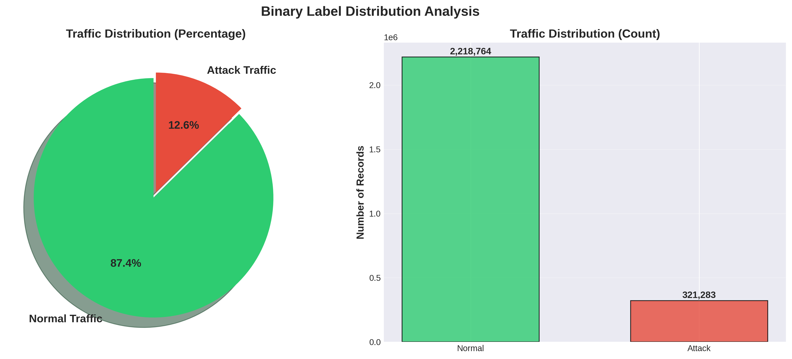
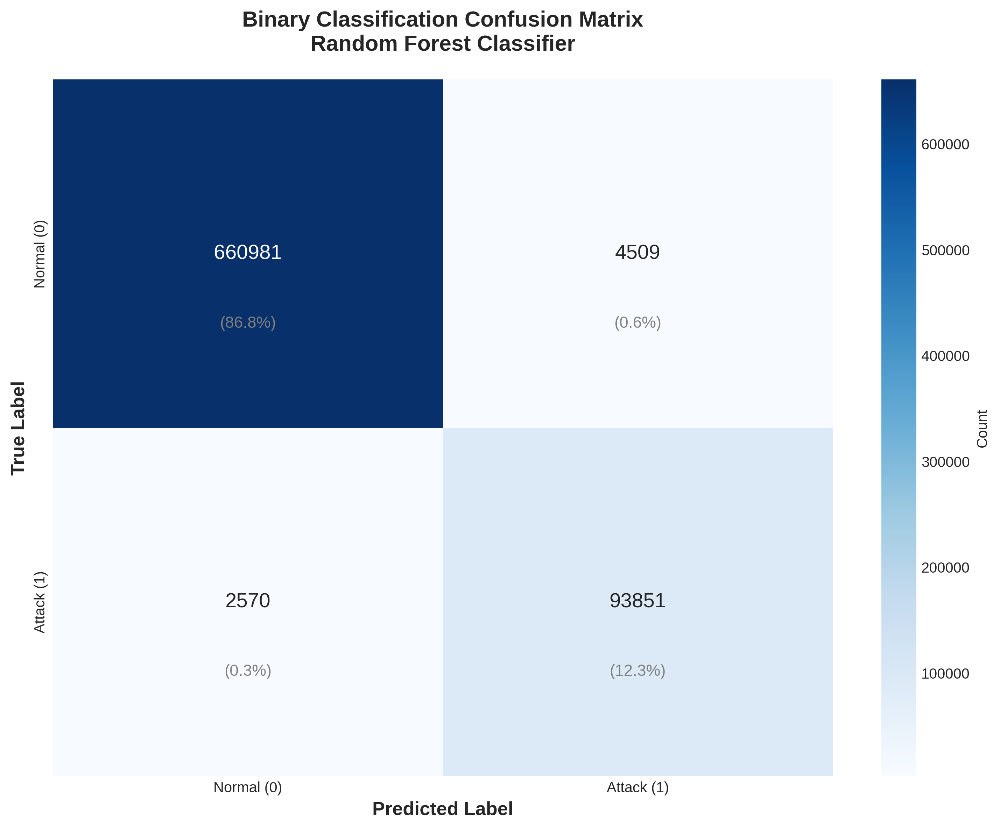
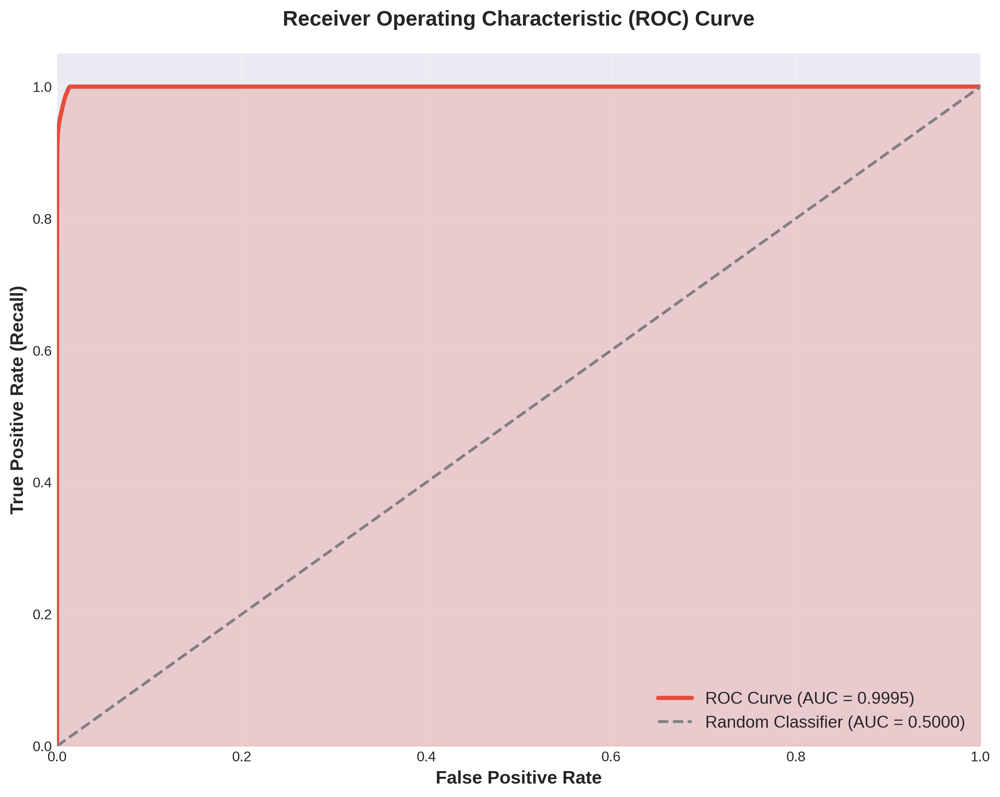
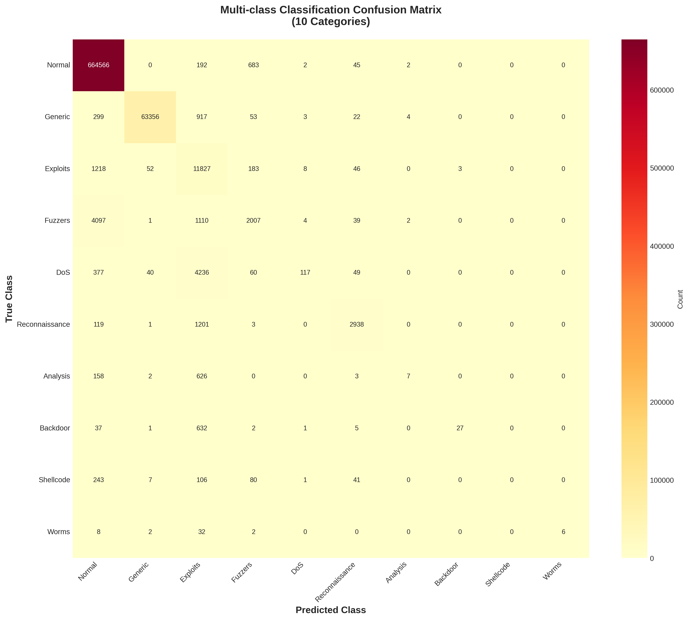

# Big Data Network Intrusion Detection System (UNSW-NB15)

An end-to-end Big Data cybersecurity pipeline utilizing **Apache Spark (PySpark)** and **Apache Hive** for high-throughput network traffic analysis, anomaly detection, and machine learning classification on the **UNSW-NB15** dataset (~2.54 million network flow records).

---

## 📌 Project Overview

Modern network environments generate massive volumes of traffic daily. Identifying malicious activity requires distributed computing capable of handling large-scale network telemetry in real time. 

This project implements a complete Big Data Network Intrusion Detection System (NIDS) using **Apache Spark (PySpark)** and **Apache Hive**:
- **Dataset Scale:** Processes **2,540,047 network flow records** across **49 network features**.
- **Exploratory & Statistical Analysis (Part 1):** Distributed summary statistics, correlation matrices, and distribution profiling to understand traffic behavior.
- **Binary Classification (Part 2):** High-accuracy Random Forest classifier distinguishing between **Normal** and **Malicious** network traffic with **99.07% accuracy** and **99.95% AUC-ROC**.
- **Multi-class Classification (Part 3):** Classifies traffic into **10 distinct categories** (1 Normal + 9 Attack Types: Fuzzers, Analysis, Backdoor, DoS, Exploits, Generic, Reconnaissance, Shellcode, Worms) achieving **97.76% accuracy**.
- **Big Data Architecture:** Fully pipelined feature engineering using `VectorAssembler` and `StandardScaler` combined with distributed machine learning models capable of scaling across computing clusters.

---

## 📊 Results Summary & Visuals

### 1. Dataset Breakdown

| Metric | Value | Description |
|---|---|---|
| **Total Records** | **2,540,047** | Network flow connection records |
| **Normal Traffic** | **2,218,764 (87.35%)** | Legitimate enterprise network activity |
| **Attack Traffic** | **321,283 (12.65%)** | Malicious traffic across 9 attack families |
| **Feature Dimension** | **49 features** | Flow metrics, packet counts, jitter, TTL, flags |
| **Attack Categories** | **9 categories** | Fuzzers, Analysis, Backdoor, DoS, Exploits, Generic, Reconnaissance, Shellcode, Worms |

<p align="center">
  
</p>

---

### 2. Binary Classification Performance (Normal vs Attack)

Trained with a distributed **Random Forest Classifier** (100 trees, max depth 10) on a 70/30 train-test split (761,911 test instances):

| Metric | Score | Details |
|---|---|---|
| **Accuracy** | **99.07%** | `0.990709` |
| **AUC-ROC** | **99.95%** | `0.999547` |
| **F1-Score** | **99.07%** | `0.990748` |
| **Precision** | **99.08%** | `0.990816` |
| **Recall** | **99.07%** | `0.990709` |
| **True Negatives (TN)** | **660,981** | Correctly identified benign connections |
| **True Positives (TP)** | **93,851** | Correctly detected intrusions |
| **False Positives (FP)** | **4,509** | Normal connections flagged as attacks |
| **False Negatives (FN)** | **2,570** | Undetected intrusion instances |

<p align="center">
  
  
</p>

---

### 3. Multi-class Classification Performance (10 Categories)

Identifies specific attack vectors across **10 classes** (Normal + 9 attack categories):

| Metric | Score | Details |
|---|---|---|
| **Accuracy** | **97.76%** | `0.977609` |
| **Weighted Precision** | **97.78%** | `0.977821` |
| **Weighted Recall** | **97.76%** | `0.977609` |
| **Weighted F1-Score** | **97.31%** | `0.973102` |
| **Training Records** | **1,778,136** | 70% training split |
| **Testing Records** | **761,911** | 30% testing split |

<p align="center">
  
</p>

---

## 📁 Project Structure

```
Network-Intrusion-Detection-System-Big-Data-Analytics/
├── .gitignore                          # Git ignore rules (excludes >100MB files, zips, cache)
├── README.md                           # Project documentation & execution guide
├── requirements.txt                    # Project Python & PySpark dependencies
├── merge_dataset.py                    # Stream-merging utility for raw partition files
├── data/
│   ├── UNSW-NB15_features.csv          # Feature definitions and data types
│   ├── UNSW-NB15_LIST_EVENTS.csv       # Attack category mappings & event details
│   └── UNSW-NB15 Dataset.txt           # Dataset documentation
├── scripts/
│   ├── pyspark_part1_statistical_analysis.py       # Distributed descriptive stats & correlations
│   ├── pyspark_part2_binary_classification.py      # Binary Random Forest classifier & model export
│   ├── pyspark_part3_multiclass_classification.py  # 10-class Random Forest attack classifier
│   └── visualize_hive.py                           # Visualization generator for Hive query outputs
└── results/
    ├── hive_results/                   # Raw MapReduce / Tez partition outputs from Hive
    │   ├── query1/                     # Traffic & attack category distribution
    │   ├── query2/                     # Protocol and service vulnerability analysis
    │   └── query4/                     # Connection state statistics
    ├── hive_visualizations/            # Plots generated from Hive queries (PNG)
    │   └── summary_statistics.txt
    └── pyspark_results/                # PySpark model evaluation metrics and visualizations
        ├── ids_binary_model/           # Exported trained PySpark Pipeline model
        ├── *.csv                       # Classification reports, metrics, feature importances
        └── *.png                       # Confusion matrices, ROC curves, metric comparisons
```

---

## 🛠️ Step 1: Dataset Setup (Download, Merge & Clean Up)

The unified dataset file `data/UNSW-NB15.csv` is approximately **580 MB** in size and exceeds GitHub's 100 MB per-file upload limit. Follow these steps to obtain and prepare the data:

### 1. Download the Partition Files
Download the 4 raw UNSW-NB15 CSV files (`UNSW-NB15_1.csv`, `UNSW-NB15_2.csv`, `UNSW-NB15_3.csv`, `UNSW-NB15_4.csv`) from the [official UNSW-NB15 repository](https://research.unsw.edu.au/projects/unsw-nb15-dataset) or [Kaggle](https://www.kaggle.com/datasets/mrwellsdavid/unsw-nb15).

Place all 4 downloaded files inside the `data/` folder:
```
data/UNSW-NB15_1.csv
data/UNSW-NB15_2.csv
data/UNSW-NB15_3.csv
data/UNSW-NB15_4.csv
```

### 2. Merge Partitions and Attach Headers
Run `merge_dataset.py` from the project root. This script streams the four partitions and attaches the official 49 column headers without overloading system RAM:

```bash
python merge_dataset.py
```

*Output:* `data/UNSW-NB15.csv` (2,540,047 records, ~580 MB).

### 3. Clean Up Raw Partition Files
Once `data/UNSW-NB15.csv` has been generated, delete the partition files to save disk space:

- **Linux / macOS / Google Colab:**
  ```bash
  rm data/UNSW-NB15_1.csv data/UNSW-NB15_2.csv data/UNSW-NB15_3.csv data/UNSW-NB15_4.csv
  ```

- **Windows PowerShell:**
  ```powershell
  Remove-Item data\UNSW-NB15_1.csv, data\UNSW-NB15_2.csv, data\UNSW-NB15_3.csv, data\UNSW-NB15_4.csv
  ```

---

## 🚀 Step 2: How to Run the Project

### Option A: Local Execution

#### 1. Clone the Repository
```bash
git clone https://github.com/HeerRana/Network-Intrusion-Detection-System-Big-Data-Analytics.git
cd Network-Intrusion-Detection-System-Big-Data-Analytics
```

#### 2. Install Dependencies
Ensure you have Python 3.8+ and Java 8/11/17 (required for Apache Spark) installed, then run:
```bash
pip install -r requirements.txt
```

#### 3. Execute PySpark Analysis Scripts
Execute each script from the project root:

```bash
# Part 1: Statistical & Exploratory Data Analysis
python scripts/pyspark_part1_statistical_analysis.py

# Part 2: Binary Classification (Normal vs Attack) + Save Model
python scripts/pyspark_part2_binary_classification.py

# Part 3: Multi-class Classification (Normal + 9 Attack Categories)
python scripts/pyspark_part3_multiclass_classification.py
```

*(Optional) To re-generate charts from Hive query results:*
```bash
python scripts/visualize_hive.py
```

All generated metrics, classification reports, and visual charts will be saved to `results/pyspark_results/` and `results/hive_visualizations/`.

---

### Option B: Google Colab Execution

You can run the full PySpark pipeline on Google Colab with free GPU/CPU runtimes:

```python
# 1. Mount Google Drive (if storing data in Drive)
from google.colab import drive
drive.mount('/content/drive')

# 2. Clone repository & install dependencies
!git clone https://github.com/HeerRana/Network-Intrusion-Detection-System-Big-Data-Analytics.git
%cd Network-Intrusion-Detection-System-Big-Data-Analytics
!pip install -r requirements.txt

# 3. (Optional) Run dataset merge if partition files are staged
# !python merge_dataset.py

# 4. Run PySpark Analysis
!python scripts/pyspark_part1_statistical_analysis.py
!python scripts/pyspark_part2_binary_classification.py
!python scripts/pyspark_part3_multiclass_classification.py
```

---

## 🛡️ License & Acknowledgments

- **Dataset:** UNSW-NB15 created by the Cyber Range Lab of the Australian Centre for Cyber Security (ACCS).
- **Technologies:** Apache Spark, PySpark MLlib, Apache Hive, Scikit-learn, Pandas, Matplotlib, Seaborn.
